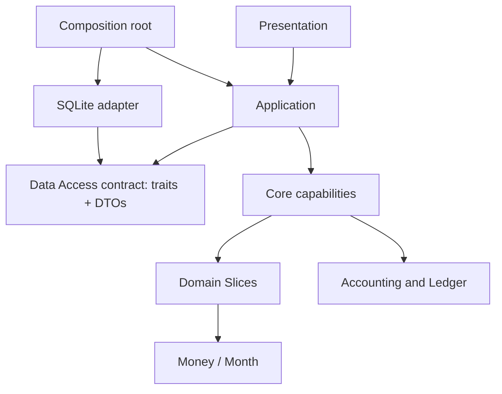

# 架构与依赖边界

## 当前方向

当前 Core crate 与主要模块职责已形成实现基线，供 Application 接线使用。后续按具体用例、领域规则和验证结果增量调整，不要求在 Application 开始前再进行一轮全面重构。已确认的依赖方向和职责如下：

已确认的设计方向：

- 将 `Money`/`Currency` 和模拟内月份序号分别放入职责单一的 `money`、`month` crates。`Month(0)` 是初始化边界，首个计算月为 `Month(1)`；月份值同时作为一次模拟内的期间键。当前不预建通用 ID crate。
- 不保留职责宽泛的通用 `models` crate。贷款计算、维修分布等行为与使用它们的领域 Slice 一起设计和维护。
- 账务能力按 `account`、`journal-entry`、`ledger` 和 `reporting` 划分：账户值、Slice 返回的平衡账务记录、append-only journal、派生报告分别有明确责任。`journal-entry` 是 Slice 与 Ledger 共享的值契约；Slice 创建并验证记录，Ledger 校验账户引用等 Ledger 专属约束后追加。Reporting 接收只读账簿数据并纯计算试算平衡、资产负债表、期间损益、原始现金账户变动和审计结果；Ledger 不调用 Reporting，Reporting 不接收或修改 Ledger 对象。
- `slice-catalogue` 定义可用 Slice 及其参数、每期输入、事件和单次调用结果契约；catalogue 不依赖 Application 聚合状态或 Slice 实现。
- Application 持有模拟配置和随机 root，并组织每月结果；Core 不定义通用 Context 或 Snapshot 聚合类型。Application 从配置中选择当月有效参数并创建 Slice；各 Slice 独立计算并返回自己的结果和 JournalEntry。
- Application 管理一次模拟的跨月流程、Slice 实例生命周期和本月执行协调：选择、创建并调用所需 Slice，收集结果并将 JournalEntry 追加到候选 Ledger。Core 不提供统一的跨 Slice 业务聚合器；Slice 之间不依赖执行顺序。当前范围不实现并行调度。
- Core 提供独立的 Slice 计算、Ledger 更新和 reporting 投影能力。现金流从 Ledger 分录和调用方提供的现金科目/分类映射推导；不要求 Slice 活动实例来源信息。
- Application 在模拟初始化时取得并保存模拟级随机 root，Data Access 独立持久化该值；Random engine 根据调用方传入的 root 和语义身份派生随机输入，不访问系统熵。领域分布和计算模型消费显式随机输入。
- Application 通过 `data-access` crate 中的 storage-neutral DTO 和语义持久化 trait 与存储交互；SQLite adapter 实现这些 trait。Application 采用泛型静态分发，具体 adapter 在启动组合时注入；Application 不依赖 SQLite/SQLx crate，也不使用 `dyn Trait`。

## 依赖原则

图中是方向约束，不代表已经确定的全部 crate 划分或最终调用协议。Application 依赖 `data-access` 契约 crate，而不依赖具体 SQLite adapter；adapter 和 Application 各自依赖该契约，程序初始化层负责创建 pool、adapter 和 Application 并完成注入。Application 用泛型参数承载 adapter 的具体类型，保持静态分发。Core、Application 和 CLI/GUI/Web Presentation 可在同一仓库的不同 Cargo workspace 中维护。依赖须指向提供值类型或规则的一侧；领域计算不得依赖 Application、Presentation、数据库、文件或系统随机熵。具体模块接口应在 `core/` 的设计过程中验证。

## 概念职责

| 概念 | 责任方向 | 尚需明确的边界 |
|---|---|---|
| Money / Currency | 精确金额、币种和舍入不变量 | 与会计分录精度规则的接口 |
| Month | 一次模拟内从 0 开始的时间位置；0 为初始化边界，1 为首个计算月 | 月份递增和间隔；不是全局 ID |
| Account / JournalEntry / Ledger / Reporting | 账户规则、Slice 返回的平衡分录、append-only journal 和派生报表 | 高层注入现金流科目分类；Reporting 校验分类明细与 Ledger 现金变动相符 |
| Slice | 单项领域行为及其参数、样本、计算和输出；`SliceKind` 标识受支持行为 | Application 如何选择、创建、结束和调用 Slice；具体生命周期规则仍需明确 |
| Random engine | 从调用方持有的 root 和显式语义身份派生随机输入 | root 生成与持久化归 Application/Data Access；派生算法及随机输入 trait 由 Core 提供 |
| Application simulation state / monthly output | 保存模拟级配置与 root，并组织已完成月份的 Slice 结果 | 应用状态和持久化 DTO 的字段边界；Core 只定义单项计算契约 |
| Application | 用户用例、跨月流程、逐 Slice 调用协调、候选 Ledger 结算和数据读写协调 | 具体用例及窄的 Core 调用接口 |
| Data Access contract | storage-neutral DTO 与异步持久化操作 | DTO、SQLite schema 和按模拟、设置、月度事实划分的 store trait 已实现；组合 `DataAccess` trait 供需要完整能力的调用方使用。月度事实支持全量读取和按指定 Month 读取事件/分录。未来若运行时需要跨线程派发，再决定是否增加 Future 的 `Send` 约束 |

## 上下层边界

- **Application** 是 Presentation、Data Access 和计算能力之间的协调点。它处理期初初始化、跨月推进、停止条件、配置更新、随机 root 生命周期和月度结果保存与查询。
- **Data Access** 的 DTO、统一持久化 trait 和 SQLite adapter 已实现。SQLx 和 schema 细节不进入调用方或 Core；程序运行流程仍由 Data Access 之外负责。
- **Presentation** 负责用户输入格式、默认值和结果展示，不直接调用 Data Access 或领域计算模块。
- **Core** 由基础值类型、单项领域行为、Accounting/Ledger 和随机输入能力组成。模拟级状态与月度结果的组织属于 Application。最终 crates 数量以职责与依赖验证结果为准。

不引入全局服务定位器、泛化插件目录或为未知行为预建的通用框架。重大边界决定记录在 ADR；旧 ADR 可以说明历史选择，不自动约束新结构。

## 验收原则

Core 当前实现作为可独立验证的工作基线。增加或调整模块时，说明其负责的数据、不变量、操作、输入输出和依赖对象，并以领域测试验证；不要求为满足预先固定的 crate 布局而机械拆分或迁移。
