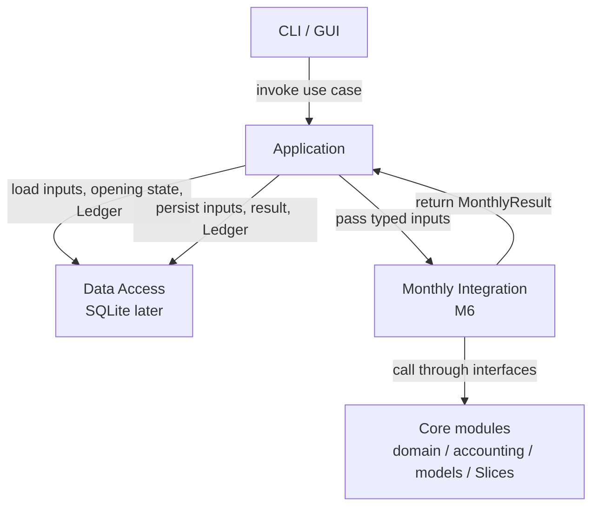

# 架构与模块边界

> 本文保留原规范章节编号，便于和既有讨论对应。首版实施基线以本文及 [实施路线](implementation-roadmap.md) 为准。

## 2. 已确认决策摘要（正式 ADR 索引）

下表是当前基线的决策索引；正式记录见 [`docs/adr/`](adr/README.md)。

| ID | 决策 | 解释 |
|---|---|---|
| ADR-01 | 月度计算时间单位 | 原运行控制提案已由 ADR-27 取代；当前模块不定义运行生命周期 |
| ADR-02 | 统一 **monthly tick** | 一次领域计算使用一个年月；不表示当前已有运行器或月度事务协调器 |
| ADR-03 | 从**任意有效初始快照**开始 | 不要求补齐模拟前的购房/还贷事件 |
| ADR-04 | 配置预设 + 用户覆盖 | 仅描述配置来源；不定义运行场景/分支生命周期，初始事实与未来假设分离 |
| ADR-05 | Slice 独立计算 | 原统一提交器已由 ADR-28 取代；当前 Slice 返回独立输出，不直接写 Ledger |
| ADR-06 | Event、Effect、Ledger 分离 | 事件说明发生了什么；Effect 改变状态；Ledger 记录经济事实 |
| ADR-07 | 现金流按月入账 | 保留每笔明细及其来源，月末产生聚合视图 |
| ADR-08 | 数据集作为 Core 输出 | 已由 ADR-27/29 取代；M6 返回单月结果，历史由应用层通过数据访问保存 |
| ADR-09 | 随机输入显式提供 | 采样使用调用方提供的随机输入；Core 不管理运行随机流或结果重放 |
| ADR-10 | 交付阶段 | 当前按 M5 Core 模块、M6 单月整合、后续应用/数据访问、CLI/GPUI 展开，详见 ADR-29 与路线图。 |
| ADR-11 | 初期 Rust 静态注册 | 暂不做动态插件、通用配置语言或异步服务架构 |
| ADR-12 | 初始随机范畴独立 | 自然环境、房屋/组件、政策/宏观、居住/运营范畴间按独立处理；Slice 只读期初状态和冻结输入中的共享状态，不读其他实例的当月结果。未来相关性须作为明确的模型设计。 |
| [ADR-13](adr/ADR-13-ledger-profile.md) | 家庭房产 Ledger | 最小科目范围、期初净值及同月权责/现金简化 |
| [ADR-14](adr/ADR-14-mortgage-interest.md) | 贷款利息计算 | 月利率、按余额/期限推导月供、本金/利息分配、末期结清和舍入规则 |
| [ADR-15](adr/ADR-15-random-streams-and-branches.md) | 随机流与重新抽样 | 随机输入边界；未完成运行不要求 checkpoint 恢复（ADR-21） |
| [ADR-16](adr/ADR-16-configuration-and-run-control.md) | 配置与运行控制 | 运行控制与分支段落为历史提案；当前应用流程尚未设计 |
| [ADR-17](adr/ADR-17-money-and-identifiers.md) | 货币金额与标识符 | 单币种账本、不兑换；强类型 ID 与科目代码分离 |
| [ADR-18](adr/ADR-18-sufficient-state-transition.md) | 充分状态与单期转移 | 完整期初状态、当期输入/随机输入决定当期结果；历史仅作显式状态或审计记录 |
| [ADR-19](adr/ADR-19-validation-only-domain-errors.md) | 验证边界与计算错误 | 可纠正的结构问题在输入边界拒绝；计算函数返回类型化错误，不定义运行生命周期 |
| [ADR-20](adr/ADR-20-composable-slices-and-random-sampling.md) | Slice 组合、来源标识与随机采样解耦 | 所有可接受实例结果按交换律、结合律组合；无实例依赖；采样分布、采样器和 Slice 分离 |
| [ADR-21](adr/ADR-21-m3-run-randomness-and-persistence.md) | 随机输入与采样边界 | 调用方注入随机源；Core 不管理随机流状态、运行历史或恢复 |
| [ADR-22](adr/ADR-22-m3-run-inputs-snapshot-and-cashflow-contract.md) | 月度输入与 Ledger 派生现金流 | M3 运行/快照是历史实现；当前目标由 ADR-27 定义 |
| [ADR-23](adr/ADR-23-loan-ledger-account-granularity.md) | 贷款 Ledger 科目粒度 | 每笔贷款独立负债科目，利息费用科目共享 |
| [ADR-24](adr/ADR-24-m4-operating-activity-contracts.md) | M4 运营活动契约 | 物业税与公用事业活动边界、配置和来源 |
| [ADR-25](adr/ADR-25-m5-in-memory-core-contract.md) | M5 内存数据契约 | 历史归档范围已由 ADR-27 取代；不定义常驻运行对象 |
| [ADR-26](adr/ADR-26-scenario-scoped-runtime-and-concurrency.md) | 单线程计算边界与延后场景管理 | 当前计算模块不管理场景集合或调度 |
| [ADR-27](adr/ADR-27-current-month-runtime-and-database-owned-history.md) | 月度计算边界与 Ledger 派生现金流 | M6 处理单月输入/输出；Application/Data Access 管理持久化 |
| [ADR-28](adr/ADR-28-pre-m5-crate-call-boundary-review.md) | M5 前 crate 调用边界检查 | 已完成依赖/调用盘点和生产边界整改；不预设 controller/work unit |
| [ADR-29](adr/ADR-29-layered-calculation-and-application-boundaries.md) | Core、单月整合、应用与数据访问边界 | M5 完成底层模块；M6 完成单月整合；应用层唯一协调数据访问和计算 |
| [ADR-30](adr/ADR-30-monthly-integration-inputs-and-atomic-settlement.md) | M6 调用方注入 Slice 适配器与 Ledger 原子结算 | 异构 Slice 通过窄适配器调用；候选账簿结算成功后仅返回本月凭证增量及派生投影 |


## 6. Slice 架构与契约

### 6.1 目标

领域计算的基本契约是“完整期初状态 + 当期冻结输入 + 当期随机输入 → 完整月度结果”。结果包含期末状态。Slice 是计算规则的代码边界，不是活动种类的固定容器：实现和活动实例不要求一一对应；一个实现可处理多个同类独立实例，也可由多个实现共同计算一项活动。每个生效活动经相应规则计算后产生带来源的事件、Effects 和 Ledger 交易。规则只依赖同一份期初状态、显式输入和该实例的显式随机样本；Slice 实例不得读取同月其他 Slice 的结果，也不得通过依赖或顺序传递中间结果。所有被接受的实例结果组合都必须满足交换律和结合律；无法满足时在组合边界拒绝。若需要历史信息，其继续有效的影响必须已进入明确定义的状态字段。事件与账簿历史可供审计、展示和投影，不作为隐式计算上下文。**Slice 不得直接修改共享世界或 Ledger。**

输入验证器负责拒绝并报告用户可修正的结构问题，并产生满足不变量的冻结输入。该边界之后，状态转移、余额重算和投影不得因缺失引用、分类或投影前置条件而失败。金额采用有限 `i128` 表示；运行时 checked overflow 是显式失败，不能包装成经济结果，也不能静默夹值。未预见的不变量破坏、实现缺陷或基础设施故障由计算函数返回错误；错误调用不生成成功结果，调用方负责将 fatal 错误作为本次模拟失败处理。当前 Core 不定义失败运行恢复/重试或外部持久化一致性保证。

当前生产 API 提供独立的输入验证、样本生成/校验、Slice 提案和纯提案组合函数；M6.1 定义 `MonthlyInput`/`MonthlyResult` 契约，M6.2 增加异构适配器调用和期初准备。`MonthlyInput` 通过 `RepairCostDistribution` 支持显式维修样本校验；贷款延续仍以独立类型输入，因为贷款尚未实现 `SimulationSlice`。M6.2 每次调用要求非贷款活动、样本和适配器一一对应，并检查贷款活动与延续值的身份和币种；普通 Slice 以相同 `ValidatedInput` 独立评估，输出按活动 ID 排序。尚未提供提案组合、完整结果装配、账簿提交或 Ledger 投影计算。旧 `coordinate_month`、run control、archive 和贷款批次组合只保留在 `crates/simulation/src/test_support/`，由测试编译，其结果类型为测试专用 `TestMonthlyResult`。它们记录早期组合行为，不是生产调用边界。M6.3–M6.4 继续完成提案组合与结算。M6 不等同于 controller、运行控制或应用层调度。

### 6.2 当前 Rust 实现

当前静态 Slice 契约定义在 [`activity.rs`](../crates/simulation/src/activity.rs)：每个实现声明类型化 `Sample`、`SAMPLE_KIND`、所属活动实例、资源声明和样本转换；`propose_slice` 校验样本实例/Slice/月份及配置类型，再把只读状态、冻结输入和不透明的已验证样本交给 Slice。Slice 返回提案，不能直接修改共享状态或 Ledger。资源与提案合并分别由 [`composition.rs`](../crates/simulation/src/composition.rs) 和 [`proposals.rs`](../crates/simulation/src/proposals.rs) 负责。

`propose_slice` 只调用调用方传入的 `SimulationSlice` 接口并返回绑定来源的 `SliceOutput`。`evaluate_monthly_slices` 先通过调用方提供的 `LedgerRead`、`RepairCostValidation` 验证月度期初上下文，再通过对象安全的 `MonthlySliceAdapter` 调用异构 Slice；`BoundSliceAdapter<S>` 将具体 Slice 与其类型化样本绑定。适配器与输入样本必须按身份和值匹配，输出按活动身份排序。`identify_proposal`、`merge_proposals` 与 `validate_composition` 仍是独立函数，M6.2 不负责组合。输入验证依赖注入的 `LedgerRead`，贷款条款变换依赖注入的 `LoanCalculation`。随机源与采样器通过接口传入。实例顺序、分组和执行顺序不构成隐式依赖。

### 6.3 共享资源与冲突

- 每个活动 Slice 实例按冻结输入生成强类型 `ResourceKey` 的 `reads` 与 `writes` 声明，不声明实例依赖。所有实例读取同一份期初状态，因此读写交叠不表示先后关系。来源不符、重复实例、未声明 Effect/凭证账户写入及不能兼容组合的状态写入在组合边界拒绝。账簿科目资源键采用固定账户 ID 编码。
- 所有被接受的 Slice 实例结果组合必须满足结合律和交换律，并提供空结果作为单位元；重排或分组不改变合并结果。此代数性质不表示当前实现并行执行。相同状态值可幂等合并，冲突值拒绝；现金变化保留为独立凭证，由 Ledger 批量验证及投影，不通过顺序解决冲突。
- 月度结果按当期活动的 Ledger 交易及其来源推导；现金余额按分录计算，现金流按账户和分类投影。保留逐项活动及来源，不以净额替代活动记录。随机模型可决定活动是否发生及其数值，由活动规则生成对应结果。
- 多笔贷款由同一贷款规则实现逐笔计算并分别保存状态；首版贷款实例之间不建立相关性或联动规则。贷款作为普通 Slice 活动影响期初状态或月度现金流，不设置特殊资金用途/资金流向机制。
- Effect 显式声明 `ResourceKey` 目标；相同资源的相同状态值可幂等共存，异值写入拒绝。现金影响保留为独立、可追踪的复式凭证，由 Ledger 按账户推导余额，不在提案合并时净额化。
- 所有提案带 `slice_id`、Slice 实例 ID、`source_event_id`（若有）和 `period`。
- Slice 实例由调用方赋予稳定 ID；`identify_proposal` 使用调用方注入的 `OutputIdFactory`，按月份、实例 ID、输出类型和稳定输出键生成 ID。当前 Core 不要求 trial 或 branch 身份。ID 不依赖执行顺序或分组。


## 13. Rust Workspace 与依赖方向

M0-B 建立了当前 workspace 编译边界，代码位于 `crates/`。下表描述当前 crate 的依赖和代码内容；它不等同于月度调用/组合架构。M5 完成底层模块，单月整合由 M6 提供：

| Crate | 职责 | 依赖 |
|---|---|---|
| `property-simulation-domain` (`domain`) | 领域值、实体、不变量与纯领域规则 | 无 workspace crate 依赖 |
| `property-simulation-accounting` (`accounting`) | 科目、凭证、分录、余额和报表投影 | `domain` |
| `property-simulation-models` (`models`) | 领域模型策略与概率分布 | `domain` |
| `property-simulation-simulation` (`simulation`) | 输入验证、类型化活动、独立 Slice 计算、来源识别及提案组合函数 | `domain`、`accounting`（值类型/注入接口）、`models`（模型值/注入接口）；`randomness` 仅为开发测试依赖 |
| `property-simulation-randomness` (`randomness`) | OS 熵适配、短期运行密钥与语义 ChaCha12 子流 | `domain`、`models` |

生产 `simulation` 不依赖 `randomness`。Slice 采样函数接收调用方提供的 `RandomSource` 和 `Sampler`；OS 熵读取与语义流分配由调用方负责。测试夹具使用 randomness crate 验证采样隔离。

Crate 内部保持小而明确的模块边界。`simulation::lib.rs` 只声明模块并重导出当前公开 API；`error` 保存输入、提案和计算错误，`types` 保存共享状态、类型化活动配置和提案数据（历史月度结果类型仅在测试编译），`activity` 负责样本来源校验及 Slice 调用契约，`proposals` 负责稳定 ID 识别、来源链接和提案合并，`validation` 负责输入约束；`slices::rental`、`slices::repair` 与 `slices::property_tax` 分别实现相应活动规则。物业税 Slice 只读取活动配置和冻结月份，并通过共享提案契约输出经营费用凭证。所有 Slice 依赖共享契约及领域/账务值，不由通用协调代码反向依赖具体 Slice。`accounting::transaction` 定义不可变凭证/分录及来源数据契约；`accounting::ledger` 定义账簿计算值，并提供交易验证、批次过账和余额推导操作，账簿值由调用方在计算中传入和接收，不是全局或跨调用驻留状态。`models::lib.rs` 同样只聚合模块；`repair_cost` 管理维修成本支持范围，`sampling` 定义采样器接口。新增 Slice 应放在独立模块，并通过既有契约接入。

### 13.1 当前公开计算边界（M5.1）

下表按 crate 的生产导出归纳调用边界，不逐项重复值类型的构造器和读取器。输入均由调用方持有并显式传入；模块不隐式保留跨调用状态。部分方法会按签名更新调用方持有的值：例如 `ChartOfAccounts::insert`、`Ledger::post`/`post_batch`、输入预检记录，以及随机源/采样器推进自身状态。Ledger 批次过账会先验证候选副本，再更新接收者。表中的“错误”是入口的返回类型；详细错误分类由对应类型定义。

| 模块 / 入口 | 输入 | 输出 / 错误 | 协作与状态边界 |
|---|---|---|---|
| `domain`：`YearMonth` / `YearMonthRange`、`Currency` / `Money`、强类型 ID | 调用方提供的年月、范围、币种、金额和标识；Money 支持解析、checked 加减/取负/绝对值/整数乘法/比较及入账舍入 | 类型化值及 `DomainError`（适用的构造/算术操作）；`ResourceKey::new` 返回静态字符串错误；年月提供 checked 月份运算和含端点区间 | 共享值与基础不变量；无其他 workspace crate 调用、全局状态或 IO。`BranchId`、`RunId`、`SnapshotId` 当前只作为导出类型，未参与生产计算；`TrialId` 由 randomness 适配器使用。清理这些未使用导出属于后续 API 整理，不在 M5.1 删除。 |
| `accounting`：`Account` / `AccountCode`、`AccountCategory::normal_balance`、`ChartOfAccounts`、`OpeningBalance(s)`、`LedgerTransaction` 构造与校验 | 账户属性和科目代码、期初余额、凭证 ID/月期/分录/来源 | 验证后的账户/账表/期初余额/凭证或 `AccountError`；余额汇总提供净值 | `Account::new` / `new_cash_position`、`AccountCode::new` / `validate_category`、账表插入、期初余额构造和凭证构造负责各自结构约束；只依赖 `domain` 值。 |
| `accounting`：`Ledger::new` / `new_with_cash_accounts` | 账表、期初余额、可选显式现金账户集合 | `Ledger` 或 `AccountError` | 构造并验证可传递的账簿值；不调用其他 crate 的规则实现。 |
| `accounting`：`Ledger::validate_transaction`、`post`、`post_batch`、`balance` / `balances` | Ledger 值和一笔或多笔 `LedgerTransaction`；余额查询用 `AccountId` | 验证/过账成功（过账返回 `()`），或 `AccountError`；余额查询返回账户余额/余额集合 | `post`/`post_batch` 通过 `&mut self` 更新调用方持有的值；批次先在候选副本验证，成功后替换接收者。 |
| `accounting`：`validate_projection` / `project`、`ValidatedProjection::project`、`CashFlowTotals::net_change` | Ledger、包含端点的起止月、现金账户 ID，或同币种现金流分类合计 | `ValidatedProjection`、`FinancialProjection`（资产负债表、损益表、现金流量表）或净现金变动，或 `AccountError` | 仅从 Ledger 分录与来源计算投影，不维护竞争的现金余额/现金流事实；预检投影借用原 Ledger。 |
| `models`：`FixedRateLoan::validate`、`derive_payment`、`calculate_month`、`calculate_optional_loan_month` | 固定利率贷款值；可选计算入口接收 `Option<FixedRateLoan>`，其中 `None` 表示不存在或已结清 | 验证、月供或 `LoanMonth` / `Option<LoanMonth>`，或 `LoanModelError` | 贷款数学实现依赖 `domain` 数值；Simulation 需要调用贷款规则时以 `LoanCalculation` 接口注入，不由 Slice 直接调用具体模型。 |
| `models`：`RepairCostDistribution` / `RepairDistribution`、`RepairSampler`、`UtilityUsageDistribution` / `UtilityUsageSampler`，以及 `Distribution`、`Sampler`、`RandomSource` | 分布支持/概率参数、显式传入的采样器与随机源；维修样本校验还接收待验样本 | 支持边界/最小货币单位、分布/样本校验结果或类型化样本，或 `DomainError` / `SamplingError` | 概率分布描述样本规则；采样器消费调用方传入的随机源。模型 crate 不创建或保存运行随机流。 |
| `simulation::validate_input` | `FrozenInput`、维修成本分布、实现 `RepairCostValidation` 的维修规则适配器、实现 `LedgerRead` 的调用方账簿视图、`OpeningState` | `ValidatedInput`，或 `ValidationErrors` | 两个协作接口均由调用方提供。`RepairCostValidation` 暴露支持范围、最大最小货币单位和样本校验；生产 simulation 不调用维修分布的具体规则方法。 |
| `ValidatedInput::validate_activities_before_sampling` | 可变的 `ValidatedInput`、活动实例集合、`LedgerRead`、额外现金流支持 | 成功或 `SimulationError` | 校验整组活动配置及现金流支持后，将预检活动集合写入该输入值；不是常驻运行状态。 |
| `simulation::ActivityConfiguration::sample_kind`、`PropertyTaxCadence::months`、`ActivitySample::validate_for`、`PropertyTaxConfig::is_due` / `due_on` | 活动配置/排程频率；或样本、活动实例和月份；或物业税配置与目标月份 | 样本类型/月份间隔、来源校验或 `SimulationError`、物业税到期布尔值 | 类型化值上的局部映射、边界检查和排期计算；不协调其他活动。 |
| `simulation::sample_repair`、`sample_utility` | 活动实例、月份、对应分布、调用方注入的 `Sampler` 和 `RandomSource`；Utility 还要求预检过的 `ValidatedInput` | 绑定实例、Slice、月份和可选用途的 `ActivitySample<T>`，或 `SamplingError` / `UtilitySamplingError` | 只做模型与活动配置适配并标记来源；不拥有随机生成器。 |
| `simulation::propose_slice`（`SimulationSlice` 实现） | `ValidatedInput`、来源绑定的类型化 `ActivitySample`、调用方提供的 Slice 实现 | `SliceOutput`（独立提案及来源/资源记录），或 `SimulationError` | 调用注入的 Slice 接口；切片只读同一份期初状态、冻结输入和自身样本，不写 Ledger/共享状态。`RepairSlice` 借用调用方提供的 `RepairCostValidation` 完成提案前的维修样本校验。包含 Rental、Repair、Utility、Property Tax。 |
| `simulation::evaluate_monthly_slices`、`BoundSliceAdapter<S>` | `MonthlyInput`、调用方的 `LedgerRead`/`RepairCostValidation`、异构 `MonthlySliceAdapter` 列表 | 按活动 ID 排序的 `Vec<SliceOutput>`，或含期初校验/活动上下文的 `SimulationError` | 校验期初输入与完整活动集；在样本转换前核对适配器实例和声明类型，再校验 typed sample 来源/值；核对每个非贷款活动对应一个适配器和样本，并核对贷款活动对应延续值及币种。`LedgerRead` 与借用 Ledger 的对应关系由调用方保证；本 API 不采样、不组合提案、不计算贷款、不结算 Ledger。 |
| `simulation::identify_proposal`、`merge_proposals`、`validate_composition` | Slice 输出和 `OutputIdFactory`；或已识别提案集合；或资源声明与提案 | 赋 ID 的提案、合并提案或校验成功，错误为 `SimulationError` | 独立提案来源识别、重复身份/冲突检测及资源声明校验；不提交账簿，不装配完整月份。 |
| `simulation::validate_loan_input`、`validate_loan_terms_update`、`LoanSlice::propose_month`、`apply_loan_terms_update` | 贷款 Slice、可选期初贷款、账簿只读接口及注入的 `LoanCalculation`；条款更新和有效期；月计算结果及其输入贷款和计算接口；或当前贷款、更新字段、可选本金交易及计算接口 | 贷款账户/币种/负债余额与模型输入验证；按 Slice 账户校验条款更新交易；对照注入计算验证月结果并生成状态效果和 Ledger 提案；或更新后的贷款条款提案；错误为 `SimulationError` | `propose_month` 不自行实现利息计算、不写 Ledger；贷款规则实现和后续组合/过账由调用方负责。 |
| `randomness`（调用方适配层）：`RootKey`、`RunKeyFactory`、`RandomStreams` | OS 熵或显式 seed、`TrialId` 与 `SemanticIdentity` | 随机流或 `RandomnessError`；`RandomStream` 实现 models 的 `RandomSource` | 为上层采样调用提供随机源；生产 `simulation` 不依赖此 crate，当前 `simulation` 仅在测试依赖它。它不是 M5 Core 的运行控制或恢复机制。 |

`simulation` 的测试构建还会重导出 `coordinate_month`、`SimulationRun`/run control、`SimulationArchive`、贷款批次协调器、`LoanRunUpdate`、测试专用 `TestMonthlyResult` 以及交易预检辅助 API。以上全部经 `#[cfg(test)]` 限定，只供既有测试使用；不是生产入口，也不属于 M5.1 所盘点的可调用生产 API。`simulation::lib.rs` 当前生产导出中另有独立计算所需的公共数据类型（例如 `LoanContinuation` 和提案/活动值类型），其自身不构成月度整合入口。

M5.1 只完成了职责盘点和文档映射。未使用 ID 导出是否移除、以及公开类型是否需要进一步收窄，留给后续 API 审查明确处理；当前不改生产 API、计算行为或 crate 依赖。

早期单期协调器、运行控制、内存归档和贷款批次组合已移入 `crates/simulation/src/test_support/`，仅用于测试，不属于生产 crate 公开 API。当前依赖图如下；randomness 只出现在 simulation 的 dev-dependencies 中：

下图是当前 Cargo manifest 中声明的依赖，不是实际函数调用图；实际跨 crate 调用及职责归属见 [ADR-28](adr/ADR-28-pre-m5-crate-call-boundary-review.md)：

```text
accounting ─────> domain
models ─────────> domain
randomness ─────> domain, models
simulation ─────> domain, accounting, models
simulation (tests) ─────> randomness
```

已按 [ADR-28](adr/ADR-28-pre-m5-crate-call-boundary-review.md) 完成生产边界整改。跨 crate 的共享值类型和窄接口依赖保留；Ledger 读取及贷款模型计算通过调用方注入接口。Infrastructure、CLI 和 GUI 暂不建 crate，待相应应用阶段职责明确后再决定。Rust workspace 使用 edition 2024、stable toolchain 和集中配置；本地与 CI 共用 `scripts/check.sh`。

M5.6 于 2026-10-21 按当前源码复核了正常依赖图、生产导出及跨 crate 调用点：未发现需要整改的边界违规，生产 `simulation` 无 `randomness` 依赖；完整月度组合和运行/归档夹具仍仅在测试编译中。逐边调用分类及复核证据见 [ADR-28 的 M5.6 复核记录](adr/ADR-28-pre-m5-crate-call-boundary-review.md#m56-source-re-verification-2026-10-21)。

目标调用流如下；这是职责/运行时交互图，不代表当前 crate 已实现：



图中箭头表示运行时调用/数据流，不表示具体 crate 的编译依赖。Application 通过注入的窄接口调用 Data Access，具体存储适配器实现该接口；Application 不依赖 SQLite 实现。月度结果由 Monthly Integration 返回给 Application；Application 将用户输入、完整月度结果/快照数据和 Ledger 记录交给 Data Access 保存。月度结果含事件、状态变化、期末状态和按实例归属的 Ledger 派生现金流序列；其中 Ledger 更新与单独交给 Data Access 的 Ledger 记录是同一批经济事实，不形成第二套账簿；现金流不是独立账务事实。Presentation 不直接访问 Data Access 或 Monthly Integration。M5/M6 保持单线程。

早期候选目录树（不是当前结构承诺）：

```text
property-simulation-sandbox/
├── Cargo.toml
├── crates/
│   ├── simulation-core/       # domain values and independent calculation primitives
│   ├── simulation-models/     # distributions, hazards, domain models
│   ├── real-estate/           # property entities + domain slices
│   │   └── slices/
│   │       ├── acquisition_mortgage/
│   │       ├── tax_insurance/
│   │       ├── maintenance/
│   │       ├── deterioration_repair/
│   │       ├── rental/
│   │       ├── utilities/
│   │       └── disposal/
│   ├── simulation-ledger/     # accounts, transactions, validation
│   ├── simulation-application/ # Top layer: use cases, coordinates monthly calculation and data access
│   ├── simulation-storage/    # Data access implementation: SQLite and persisted inputs/results/Ledger
│   ├── simulation-export/     # application-side export adapters
│   ├── simulation-cli/        # presentation; invokes application use cases
│   └── desktop/               # GPUI
├── examples/                  # example calculation inputs/presets
├── tests/                     # golden, property, statistical tests
└── docs/
    ├── project-spec.md
    ├── architecture/
    └── adr/
```

上述树仅是早期候选结构参考，不表示这些 crate 已建立，也不承诺最终物理拆分。它不定义 monthly runner、run-control、分支或多场景调度。当前 M0-B crate 选择见本节开头；未来按真实编译边界扩展，保持 domain 不依赖 IO/展示层且不引入循环依赖。

**候选库**：`serde`、`serde_json`、`rand`/`rand_distr`、`rust_decimal`、`time`、`thiserror`、`tracing`、`clap`、`rusqlite` 或 `sqlx`、`csv`、`rust_xlsxwriter`、GPUI。具体版本与 Linux 平台兼容性在初始化时验证。


### 20.2 领域边界与建议类型

下方是早期目录建议，保留作类型归属参考，不是 M5/M6 的运行架构或 crate 拆分承诺。M5 只完善独立计算模块，M6 单月整合由更高的计算层承担；本目录不预设 coordinator/composer：

```text
crates/
  domain/          # YearMonth、金额、类型化输入、WorldState、领域 ID 与错误
  accounting/      # 科目表、凭证、分录、余额、报表投影与校验
  simulation/      # 独立 Slice 契约、提案和输入验证；不含月度生命周期协调
  models/          # 利率、贷款摊还、分布、风险/退化模型
```

如早期实现证明单一 crate 更易演进，可先用一个 crate 的模块结构，保持依赖方向和公开接口清晰，再按实际编译/所有权边界拆分。不得为了目录结构提前引入循环依赖。

**基础类型与时间**

- `YearMonth`：有效年月、排序、加减月、包含端点的区间迭代；不使用日期天数表达月度模型。
- `Money`：带显式币种代码的十进制定点金额，禁止二进制浮点参与账务计算；一个账本首版只允许一种币种，不做兑换。货币符号和本地化格式由展示层处理。
- 金额舍入：中间计算使用十进制定点精度，最终入账金额按单币种货币最小单位四舍五入（正数 midpoint half-up）。贷款利息按此规则舍入到分。当前规则固定，不通过可配置策略参数传递。
- 强类型、不透明 ID：Slice、活动实例、实体、事件、决策、凭证及账户各用独立类型；当前计算不要求场景或运行身份。`AccountCode` 是可读科目代码，不是 `AccountId`。ID 由领域调用方提供，核心计算不生成 ID；Ledger 拒绝重复凭证 ID。
- M5 的领域内存类型不依赖序列化格式。金额在领域中使用带币种的定点类型；数据库和文件导出的具体编码不属于当前计算边界。

**状态、历史与连续运行**

- `InitialWorldState` 表示起点事实，不自动创建对应的历史交易或事件。
- 初始账务输入由用户提供的所有已知资产、负债，以及用于生成未来收入/费用的假设构成；核心领域校验负责检查这些类型化输入是否足以构建期初账簿和所启用 Slice 的完整状态。界面负责格式解析和交互提示，不重复领域规则。不得静默补造余额或假设。
- `WorldState` 保存所有已知且会影响未来的领域变量，包括纳入模型的账户余额、组件状态/年龄、租赁状态、Slice 继续计算所需状态和共享环境状态。
- M6 单月整合接收期初状态和当期输入，返回包含 Ledger 变化和期末状态的完整结果；它不持有跨月运行状态或历史。应用层负责多次调用及其读写流程；数据访问由应用层调用。当前不设计分支或多场景调度，整体按单线程执行；如将来有更高层并行需求，再单独讨论（ADR-26、ADR-29）。
- 月度结果记录当期用户输入和模型生成事实的来源；继续计算所需的影响进入期末状态，不要求把历史日志作为后续月份的计算输入。
- 续跑边界必须验证充分状态：启用的 Slice 所需字段缺失时明确报错，不以隐式默认值补齐。

**事件与状态变化**

- `Event` 记录已发生事实；`Decision` 记录用户或策略选择；`Effect` 描述经过校验的状态变化；`LedgerTransaction` 记录该业务动作的会计影响。
- 记录携带稳定 ID、期间、来源 Slice、因果引用和适用实体。
- Slice 只根据只读输入和显式样本返回候选提案，不修改调用方状态或 Ledger。M5 完善各独立模块；M6 负责单月提案装配、账簿结算和完整结果生成。运行控制、数据访问与持久化不属于这两层。
- 业务事件可以有多个 Effects 和多张有明确语义的凭证；导出/查询层不得把事件、状态变化和会计事实混成一条含义模糊的流水。
