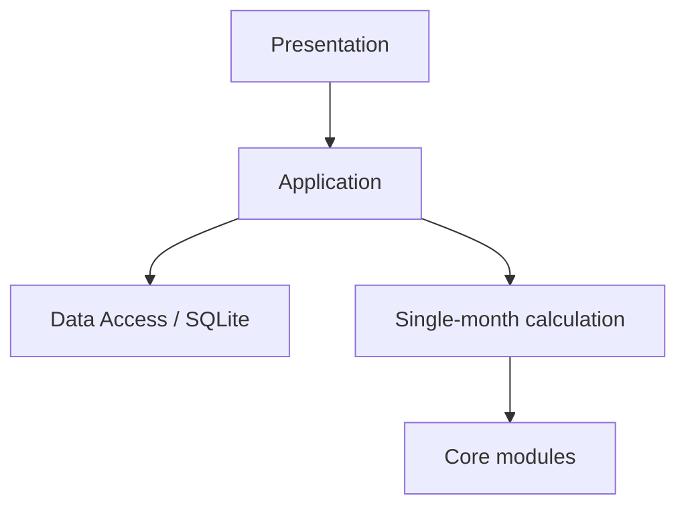

# 架构与依赖边界

## 运行时调用方向

- **Core modules**：domain、accounting、models 和各 Slice。接收显式类型化输入并返回值；不访问数据库、文件、操作系统随机源或 UI。
- **Single-month calculation**：当前由 `simulation::calculate_monthly_result` 提供。组合 Core 计算，结算候选 Ledger，返回完整月度结果或错误；不读取/保存数据、不循环月份、不持有模拟 context。
- **Application**：拥有一次模拟用例的调用流程，是 Data Access 与单月计算之间唯一协调者；不常驻持有模拟 context 或运行状态。每次用例从 Data Access 加载所需的 context、最近期末状态和 Ledger，在内存中完成一次操作，再按需持久化 context 变更或月度结果。对 UI 只暴露四类用例：设置初始值、推进一个月、获取统计报告、读取指定月份完整结果。月度请求可携带设置变更或停止命令；用例显式决定所需数据，再传入 `context + opening Ledger + 当月随机输入`，接收完整结果、评估停止条件并决定是否继续。每次读取限定于当前用例及模拟进度，不提供任意数据库查询或允许其他层绕过 Application 读取数据。Application 具有明确输入/输出的流程结构，但因读取、持久化和系统随机输入而不是纯函数。
- **Data Access**：由 Application 调用，通过窄接口按 Application 请求加载和保存类型化数据。持久化数据来自此前 UI 提交并保存的 context，以及模拟流程已产生并保存的月度结果、snapshot 和 Ledger 记录；SQLite 适配及其存储表示只属于此层。Application 不依赖具体 SQLite 实现。
- **Presentation**：拥有用户输入、用户命令、Slice 启用选择及产品默认值；解析和约束用户可见输入格式、展示结果、调用 Application 的四类用例。Application 接收明确的 context 参数，不定义 UI 默认值。Presentation 不得直接访问 Data Access 或单月计算。默认场景见 [UI 输入与默认值](ui-ux-design.md)。

代码标识符不得使用路线图中的实施阶段名称或编号。不得引入全局可变服务定位器、无需求的通用 Repository/Factory/Manager 层或底层到上层的依赖。

## 当前计算契约

单月计算输入包括完整期初状态、当月冻结输入、当月有效活动实例、显式随机样本、贷款延续值和期初 Ledger。Application 在每月调用前依据最新 context 与最近 snapshot 筛选有效实例；已停用或已终止实例不传入计算。当前 `MonthlyResult` 包含事件、状态变化、Ledger 本月凭证增量、从这些新增凭证派生的逐交易/逐来源现金流及完整期末状态，但不包含通用活动实例生命周期变化；贷款延续值可表示贷款结清。若要支持计算生成新实例或模型结束普通活动，必须扩展月度结果契约，再由 Application 将变化用于后续月份。贷款余额和相应 Ledger 负债必须一致。计算失败不返回部分成功结果，且不修改调用方期初 Ledger。

Slice 只从共同的期初状态、冻结输入和本实例样本独立计算提案；Slice 之间没有执行顺序或同月依赖。组合须满足交换律和结合律，冲突在组合边界拒绝。分布、采样器和随机源职责分离；随机输入由调用方产生。

首版先实现当前明确的模拟项目并完成端到端调用，不要求模型算法一次达到最终精度。接受的边界是显式类型化输入、样本来源和完整结果；在这些契约内可替换模型、分布和采样器的内部机制。若某项实际需求改变边界，再同步修改契约与测试；不为未出现的活动生命周期或随机相关性需求预建通用框架。

## Workspace 边界

| Crate | 职责 | 依赖方向 |
|---|---|---|
| `domain` | 领域值、实体、不变量、金额和年月 | 无 workspace 依赖 |
| `accounting` | 科目、期初余额、凭证、Ledger 与财务投影 | `domain` |
| `models` | 贷款和概率模型、采样接口 | `domain` |
| `simulation` | 输入校验、Slice 契约、提案组合和单月计算 | `domain`、`accounting`、`models` |
| `randomness` | 系统随机源适配和显式随机流工具 | `domain`、`models`；由 Application/调用方使用，不由 Core 持有 |
| Application（待建） | 模拟 context、月度流程、停止条件与用例 | Core 单月入口及 Data Access 接口 |
| Data Access（待建） | SQLite 映射与按月读写 | Application 定义的窄接口 |
| Presentation（待建） | 用户输入解析、结果展示和用例调用 | Application |

Application/Data Access 的 crate 拆分由实际编译依赖决定。Presentation 只依赖 Application；Data Access 适配器实现 Application 所需接口；Core 不依赖 Application、Data Access 或 Presentation。

Application 用例可按“读取所需的已保存输入 → 在本次调用内存中显式计算并传递参数 → 处理结果 → 保存变更/结果”的顺序组织。数据库是跨用例保留状态的持久化来源；一次用例结束后不依赖 Application 内存保留模拟进度，下次调用从数据库加载所需数据。当前用例负责选择读取范围和顺序，并只使用本次模拟已有的 context 与已完成月份数据。不要引入脱离用例流程的全局数据访问、隐式查询或常驻模拟状态服务。

## 跨月状态与持久化

Context、snapshot、Ledger、现金流来源和活动生命周期的领域含义以[领域模型](domain-model.md)为准；用例顺序、停止规则和按月保存要求以[当前工作计划](implementation-roadmap.md)为准。Data Access 只为 Application 提供窄接口，具体 SQLite 记录组织仍待设计。一次用例结束后不依赖 Application 内存保留进度；后续调用从已保存数据读取所需状态。Application 通过读取已保存月度结果提供报告和指定月份回看，不触发重新计算。

每个 crate 的模块职责、依赖箭头、输入输出边界和错误行为应在实现前可说明。仓库统一质量入口为 `./scripts/check.sh`；该脚本检查格式、Clippy、编译和测试。
