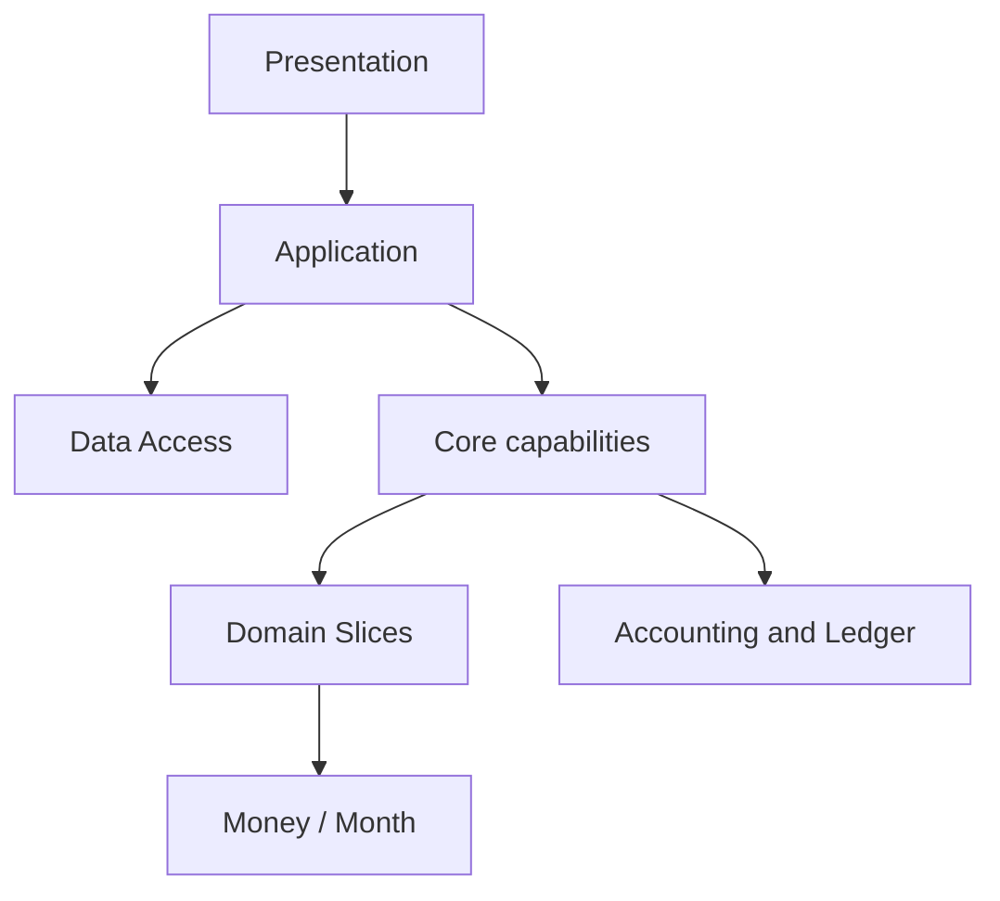

# 架构与依赖边界

## 当前方向

当前 Core 的 crate 与模块边界尚未定稿。重构先厘清概念职责、接口和依赖方向，再迁移代码；不以当前 crate 布局作为目标结构，也不以尽早得到一个可运行版本为先。

已确认的设计方向：

- 将 `Money`/`Currency` 和模拟内月份序号分别放入职责单一的 `money`、`month` crates。月份从 0 开始，首个计算月为 `Month(0)`；月份值同时作为一次模拟内的期间键。当前不预建通用 ID crate。
- 不保留职责宽泛的通用 `models` crate。贷款计算、维修分布等行为与使用它们的领域 Slice 一起设计和维护。
- 账务能力按 `account`、`journal-entry`、`ledger` 和 `reporting` 划分：账户值、Slice 返回的平衡账务记录、append-only journal、派生报告分别有明确责任。`journal-entry` 是 Slice 与 Ledger 共享的值契约；Slice 创建并验证记录，Ledger 校验账户引用等 Ledger 专属约束后追加。Reporting 接收只读账簿数据并纯计算试算平衡、资产负债表、期间损益、原始现金账户变动和审计结果；Ledger 不调用 Reporting，Reporting 不接收或修改 Ledger 对象。
- Context 与 Snapshot 分别承载模拟设置/随机 root 和已完成月份结果。Context 已确定初始设置、可选最新设置、root key 三个字段；设置值结构与 Snapshot 完整输出仍待代表性 Slice 确定。
- Application 管理一次模拟的跨月流程、有效实例生命周期与数据读写，并决定何时推进计算。Slice 的调用接口、跨 Slice 组合及 Ledger 结算之间的具体分工仍需先定义，再实现。
- Application 在创建 Context 时取得并保存模拟级随机 root；Random engine 根据 root 和语义身份派生随机输入，不访问系统熵。领域分布和计算模型消费显式随机输入。root 的具体类型、持久化映射和派生接口在新 crate 中定义。

## 依赖原则

图中是方向约束，不代表已经确定的 crate 划分或最终调用协议。Core、Application 和 CLI/GUI/Web Presentation 可在同一仓库的不同 Cargo workspace 中维护，Application 和 Presentation 只依赖 Core 所提供的接口。依赖须指向提供值类型或规则的一侧；领域计算不得依赖 Application、Presentation、数据库、文件或系统随机熵。具体模块接口应在 `core/` 的设计过程中验证。

## 概念职责

| 概念 | 责任方向 | 尚需明确的边界 |
|---|---|---|
| Money / Currency | 精确金额、币种和舍入不变量 | 与会计分录精度规则的接口 |
| Month | 一次模拟内从 0 开始的月份序号 | 月份递增、间隔及 Snapshot 期间键；不是全局 ID |
| Account / JournalEntry / Ledger / Reporting | 账户规则、Slice 返回的平衡分录、append-only journal 和派生报表 | 来源追溯、现金流分类及更完整的报表语义 |
| Slice | 单项领域行为及其配置、样本、计算和输出；`SliceKind` 限定由 Context 提供设置的受支持行为 | Application 如何选择、创建、结束和调用 Slice；依赖分组/顺序暂列技术债，待有具体依赖时再设计 |
| Random engine | 从 Context 中的 root 派生随机输入 | root 类型、派生算法及随机输入 trait |
| Context / Snapshot | Context 保存必需的模拟名称、用户初始值、停止条件、Slice 设置及独立的系统随机 root；Snapshot 保存已完成月份结果 | Core 值与持久化 DTO 的映射边界；名称由 Application 解析并注入，初始值在模拟开始后不变 |
| Application | 用户用例、跨月流程、数据读写协调 | 与逐 Slice 调用及单月结算的接口 |

## 上下层边界

- **Application** 是 Presentation、Data Access 和计算能力之间的协调点。它处理期初初始化、跨月推进、停止条件、Context 更新、Snapshot 保存与查询。
- **Data Access** 实现 Application 所需的持久化接口；SQLite 和序列化细节不得进入领域计算。
- **Presentation** 负责用户输入格式、默认值和结果展示，不直接调用 Data Access 或领域计算模块。
- **Core** 由基础值类型、领域行为、Accounting/Ledger、Context/Snapshot 相关值以及随机能力组成。最终 crates 数量以职责与依赖验证结果为准。

不引入全局服务定位器、泛化插件目录或为未知行为预建的通用框架。重大边界决定记录在 ADR；旧 ADR 可以说明历史选择，不自动约束新结构。

## 验收原则

在迁移实现前，每个模块都应能说明其负责的数据、不变量、操作、输入输出和依赖对象。以独立、可验证的接口和代表性计算为基础，再逐步迁移旧代码；旧实现只作业务规则参考，不作为模块边界模板。
