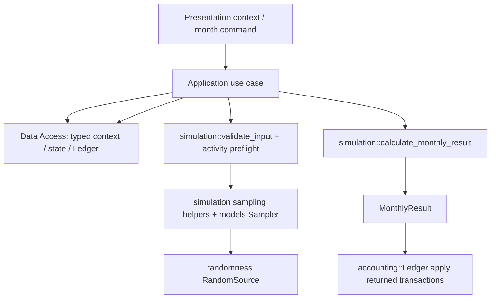

# 当前工作：应用层与数据访问层

本文件只描述尚未完成的应用层与数据访问层设计、实现和验收。Core 与单月计算边界已经存在；它们的现行契约见[领域模型](domain-model.md)和[架构](architecture.md)。代码标识符不得包含路线图实施阶段名称或编号。

## 已确认的设计基线

- 输入归属、Context/snapshot 语义、实例生命周期、Ledger 与现金流规则以及随机性约束，以[领域模型](domain-model.md)为准；依赖方向见[架构](architecture.md)，产品默认值和停止选项见[UI 输入与默认值](ui-ux-design.md)。
- Application 是唯一协调 UI、Data Access 和单月计算的层。每次用例按需读取已保存数据，在本次调用内存中处理；Application 不常驻持有模拟进度。
- 按月保存月度输入和结果；月度请求中的设置变更或命令先应用并单独保存 context，再决定是否计算。无需月度原子提交，不回滚、不补偿、不恢复；失败即停止，失败月份可能已有部分写入。
- 仅记录应用版本，不设计 schema 版本化、迁移或跨应用升级兼容。模拟结束后的长期结果保留策略不属于当前工作。
- 不设计分支、多场景管理或并行调度。首版优先完成已确定模拟项目的端到端调用，允许在不改变类型化边界的前提下替换模型、分布和采样器的内部实现。

## Application 对 UI 的用例接口

Application 对 UI 提供四个窄的用例接口。它们是产品操作边界，不是数据库 CRUD API；具体 Rust 类型、SQLite 表和查询 API 仍待设计。

1. **设置初始值**：接收 UI 已提供默认值并完成格式约束的初始 context，保存期初状态、开账 Ledger 和应用版本，返回模拟标识及初始化结果。
2. **推进一个月**：接收模拟标识及可选的用户设置变更/命令。Application 在本次调用中读取最新 context、最近一次成功的期末状态、当前 Ledger 和后续月份所需的随机状态；校验并应用变更，先保存更新后的 context。若命令为停止，则结束且不调用单月计算；否则冻结本月有效输入，使用系统随机源准备随机输入，调用单月计算，评估停止条件，并保存完整月度结果/snapshot、Ledger 增量、逐交易/逐实例现金流明细、所需随机状态和停止状态/原因。返回本月结果及模拟是否继续。用例结束后不依赖 Application 内存保留进度；下一次调用重新读取所需数据。
3. **获取统计报告**：根据当前已保存的月度结果和 Ledger 派生统计数据及结论；模拟进行中和停止后均可调用。统计项目和结论规则仍待定义，不维护与 Ledger 竞争的手工汇总事实。
4. **读取指定月份结果**：按模拟标识和月份读取此前已保存的完整月度结果，包含 snapshot、事件、Ledger 增量及逐实例现金流明细，供 UI 回看。该操作读取并展示既有结果，不重新计算月份，也不承诺随机结果重现。

设置变更作为“推进一个月”请求的可选内容传入，无需额外暴露通用 context 更新或数据库读写接口。每项已接受的用户输入均保留；用户停止命令保存后立即结束，不调用单月计算。

计算或存储失败立即停止模拟并报告系统错误；不重试、不恢复。此前已保存的数据保持现状；存储过程中失败可能留下该月的部分记录，不定义清除或修复流程。

停止条件具体计算口径、阈值边界，以及随机状态在数据库中的位置尚待设计；实现必须遵守以上调用顺序和停止语义。

## Application 调用现有下层 API 的路径

以下是当前 Rust 代码实际提供的接口盘点，用于指导 Application 与 Core 的接线；这是调用关系设计，不要求 UI 直接看到这些 API。

### 月度计算所需调用

1. 从 Data Access 读取最新 context、期初状态、期初 Ledger、贷款延续数据及月份；按 context 筛出启用的活动实例。Application 定义本地 Ledger 视图包装类型并为其实现 `LedgerRead`，从本次传入的同一个 `Ledger` 提供币种、账户事实和有符号余额（Rust 孤儿规则不允许 Application 直接为两个外部类型实现该 trait）。
2. 调用 `simulation::validate_input`，再在采样前调用 `ValidatedInput::validate_activities_before_sampling`，校验完整启用活动集合和当月现金流支持范围。维修校验通过 `RepairCostValidation` 接口提供。
3. 对随机活动调用 `simulation::sample_repair` / `sample_utility`，使用 `models::RepairSampler` / `UtilityUsageSampler` 和 `RandomSource`。确定性活动仍需构造相应的活动样本记录；贷款延续状态单独传入。
4. 为启用的非贷款活动建立对应的具体 Slice 和 `BoundSliceAdapter`，并把类型化样本与 `MonthlyInput.samples` 中的来源记录对应起来。对启用贷款建立 `LoanSlice`、`LoanContinuation`；`LoanCalculation` 由调用方接到 `FixedRateLoan::{validate, derive_payment, calculate_month}`。
5. 调用 `simulation::calculate_monthly_result`，传入 `MonthlyInput`、同一 opening Ledger 的 `LedgerRead` 视图、维修校验器、启用 Slice adapters、贷款 Slice、贷款计算器和 `OutputIdFactory`。
6. 从 `MonthlyResult` 读取期末状态、贷款延续状态、Ledger 交易增量、事件/效果及按实例 Ledger 派生现金流；更新活动实例的完成状态，并记录由计算生成的新实例（若有）。当前入口不返回更新后的 Ledger；Application 必须把返回的交易应用到自己的 Ledger 值，再将该 Ledger 和完整结果按月交给 Data Access 保存。更新后的 snapshot/活动实例集合仅供后续月份使用，不在当前月份追加计算。

报告可复用 `Ledger::cash_flow_contributions` 或 `Ledger::project` / `validate_projection(...).project()` 生成 Ledger 投影。单月现金流详情优先使用 `MonthlyResult::cash_flow_contributions()`，不得另行手工构造账务事实。

### 当前接口接线差距

- `LedgerRead`、`RepairCostValidation`、`LoanCalculation` 和 `OutputIdFactory` 是单月入口要求的调用方接口。生产代码中尚无 Application 适配器；相关契约目前只由 Core 暴露，`LedgerRead for Ledger` 仅在 Core 测试中实现。Application 需要提供本地包装/适配类型，委托给 `Ledger`、`RepairCostDistribution`/`RepairDistribution` 和 `FixedRateLoan`，并生成稳定且无冲突的输出标识，而非复制领域规则。
- Core 当前的 `MonthlyInput` 无论是否启用维修 Slice，都要求 `repair_distribution`；`FrozenInput` 也始终包含租金和维修限额等字段，`validate_input` 会验证维修支持、币种和维修限额关系。此行为与“未启用 Slice 不要求其专属参数”的 UI 契约存在差距。Application 开始实现前，需决定调整 Core 输入契约，还是由 UI context 显式提供不参与计算的有效占位值；Application 不应悄悄生成产品默认值。
- 当前月度入口接收显式样本，不负责采样；随机活动采样要求先构造并预检 `ValidatedInput`。若重复校验及样本双重表达导致接线复杂，应先评估 Core API 的边界调整，不要在 Application 中复制 Slice 计算或验证逻辑。
- 当前 `MonthlyResult` 没有通用活动实例新增、关闭或终止的生命周期变更集合；当前贷款结清可从贷款延续状态识别，租金/税费/公用事业持续，维修事件本身不结束维修活动。当前模拟项目可先按这些具体规则实现；只有在某个明确的模拟行为需要在计算期间生成/终止实例时，才扩展月度结果契约，不能让 Application 从自由文本事件名或某月无交易推断生命周期。
- `randomness::RootKey` 当前不支持序列化；随机流按 `TrialId + Slice/活动/月份/用途` 派生。随机密钥跨月的生命周期及 Application 重启时的处理尚未定，不应据此承诺恢复或重放。

## 尚待设计

- [ ] 定义四个 UI 用例的 Rust 输入、输出、错误和模拟标识：设置初始值、推进一个月、获取统计报告、读取指定月份完整结果。
- [ ] 定义月度推进请求中的设置变更与命令、context 更新的生效/持久化时点、月度有效输入冻结时点；确认停止命令保存后不调用单月计算。
- [ ] 定义期初值、context、snapshot、每月有效输入、月度完整结果和随机状态的逻辑关系；保留初始设置、最新设置及逐月输入依据。
- [ ] 按当前租金/税费/公用事业持续、维修过程持续但维修事件一次、贷款结清后终止的具体语义，实现有效实例筛选；不为尚无对应行为的未来实例生成/终止场景预建通用框架。
- [ ] 定义停止条件语义：期限边界、月末评估时点、停止原因及无有效条件时的输入约束；明确模拟中停用但未结清的贷款如何影响“贷款全部清零”。
- [ ] 定义 Data Access 窄接口及 SQLite 记录组织/查询，使初始 Ledger、最新 Ledger、月度结果/snapshot 和逐实例现金流明细能够读取并核对；不要求原子提交或回滚。
- [ ] 定义连续模拟的随机源生命周期及为下一月份继续计算所需保存的随机状态。
- [ ] 定义统计报告的数据范围、统计项和结论规则；结果须从已保存月度结果与 Ledger 派生。
- [ ] 将确定的边界规则和测试向量记录到简短 ADR，并同步本文件、领域模型及架构说明。

## 实现清单

按以下依赖顺序完成工作；每项均以前一项形成的类型和行为契约为基础。

### 1. 定义边界与类型

- [ ] 建立 Application 模块，并定义四个 UI 用例的窄接口；Data Access 与系统随机源均通过显式接口注入，不依赖 SQLite 实现。
- [ ] 定义期初 context、月度变更/命令、用例结果/错误、完整月度结果、统计报告及模拟标识等类型。
- [ ] 定义 context 中的活动实例目录与用户启用选择，以及 snapshot/月度结果中的计算生成实例和生命周期变化；每月传给 Core 的仅为有效实例。
- [ ] 将 `LedgerRead`、`RepairCostValidation`、`LoanCalculation`、`OutputIdFactory` 接到对应下层实现；保证适配器只转发并组织数据，不重复实现领域规则。
- [ ] 决定未启用维修 Slice 时 `MonthlyInput.repair_distribution` 和 `FrozenInput.repair_cost_limit` 的处理方式；使最终契约满足未启用 Slice 不要求其专属用户输入。
- [ ] 接通当前用户可选的租金、维修、贷款、房产税和公用事业模拟项目；每个 Slice 只消费显式类型化期初状态、冻结输入和样本，返回其事件、状态效果及账务提案。
- [ ] 保持随机源、分布和采样器为可替换接口；当前先实现已有的维修与公用事业采样行为，Application 负责分配系统随机输入，Slice 不持有随机引擎。
- [ ] 将 UI 提交的完整 context 和 Slice 启用状态作为输入；未启用 Slice 不进入月度计算，也不要求其专属参数。默认值由 Presentation 提供。
- [ ] 保持生产 crate、模块、类型、函数和字段命名不含实施阶段名或编号。

### 2. 设计数据访问契约与 SQLite 表示

- [ ] 定义 Application 使用的最小 Data Access 操作，覆盖初始 context/开账 Ledger 写入，最新 context/期初状态/Ledger 读取，月度记录保存，以及报告和指定月份结果读取。
- [ ] 设计内部记录及关联，覆盖初始/最新 context、用户命令、每月有效输入、完整结果/snapshot、Ledger 开账事实与交易、逐实例/Slice 现金流明细、停止原因和应用版本。
- [ ] 将 SQL、SQLite 类型及存储编码转换限制在 Data Access 层；对 Application 返回明确的类型化数据。
- [ ] 确保 Ledger 余额可由开账事实和已保存交易重算；逐实例现金流可追溯到对应 Ledger 交易。
- [ ] 不设计 schema 迁移、跨版本兼容、原子提交、回滚、补偿、恢复、分支、多场景或并行调度。

### 3. 实现设置初始值

- [ ] 接收 UI 提供的初始 context，保存初始设置、期初状态、开账 Ledger 和应用版本，返回模拟标识及初始化结果。
- [ ] 验证并持久化完整期初账务事实，保证 Core 收到的是明确、完整的期初输入。

### 4. 实现推进一个月

- [ ] 先读取最新 context；校验并应用请求携带的设置变更/命令，保留初始设置和每次已接受的用户输入，并单独持久化最新 context。
- [ ] 若用户命令停止，结束本次模拟调用，不准备随机输入、不调用单月计算。
- [ ] 否则读取最近一次成功的期末状态、最新 Ledger 和后续月份所需的随机状态；据最新 context 冻结当月有效输入。
- [ ] 合并用户启用选择与最近 snapshot 中的模型生命周期状态，排除已关闭/已完成实例；若存在计算生成的新实例，仅从本月结果保存后起纳入后续月份。
- [ ] 由 Application 接入系统随机源并准备显式随机输入；Core 不访问系统随机源。
- [ ] 调用单月计算并接收完整结果；依据期末状态及 Ledger 评估停止条件，应用 OR 语义。
- [ ] 保存当月有效输入、完整月度结果/snapshot、Ledger 增量、Ledger 派生的逐交易/逐实例现金流、继续计算所需的随机状态及停止状态/原因，然后返回月度结果和是否继续。
- [ ] 计算或存储失败即停止并报告系统错误；不返回失败月份的成功结果，不重试、恢复、隐式重算或补偿。失败月份可能已有部分写入。

### 5. 实现查询用例

- [ ] 按模拟标识和月份读取已保存的完整月度结果，包含 snapshot、事件、Ledger 增量及逐实例现金流；该查询不得触发计算。
- [ ] 基于已保存月度结果和 Ledger 生成可在模拟进行中或停止后读取的统计报告；不维护手工现金流或竞争性的汇总事实。

### 6. 验收

- [ ] 用 fake/in-memory Data Access 验证四类用例的输入输出、依赖调用顺序、context 更新、停止条件和停止命令。
- [ ] 验证成功月份的有效输入、结果/snapshot、Ledger 增量和逐实例现金流明细之间可追溯且一致；指定月份读取不重算，统计报告从保存数据派生。
- [ ] 验证关闭/终止的实例不再传入后续计算，用户关闭可重新启用，模型完成的实例不会被普通启用操作复活，新生成实例从下一月开始参与计算；历史实例仍可查询。
- [ ] 注入计算错误及存储错误，验证模拟停止并报告错误，且不调用后续月份；不要求回滚或清除部分写入。
- [ ] 对 SQLite 适配器进行集成验证，覆盖读写映射、月份排序、重载最新 context/Ledger、Ledger 对账、现金流来源及存储故障报告。
- [ ] 检查依赖方向：Presentation 只调用 Application；Application 调用 Data Access 与单月计算；Core 和单月计算不依赖 IO、SQLite 或 Presentation。
- [ ] 运行仓库统一的格式、Clippy、编译和相关验证工作流；只报告实际运行的命令与结果。

## 完成条件

一次模拟可由应用层按月顺序驱动；初始设置、最新 context 和每月实际输入均可追溯；每月结果、期末状态、最新 Ledger 和逐实例现金流明细均可持久化并核对；停止、失败和依赖边界符合以上基线。
