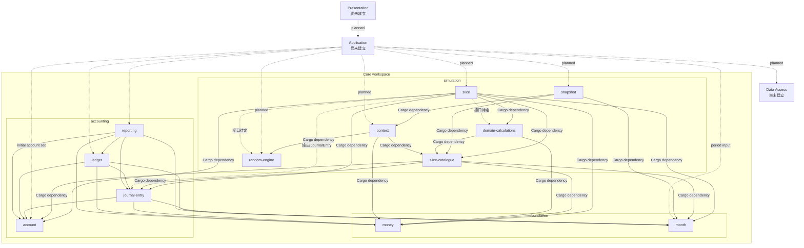
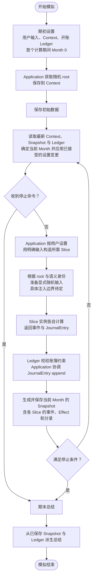

# 项目结构

本文记录当前讨论中的目标边界，不代表所有 crate 或接口已经实现。`core/README.md` 记录 Core 接口设计的后续顺序；冻结的旧实现保留在 `crates/` 作为参考，不属于活动 workspace。Core、Application 和各 Presentation 入口使用各自的 Cargo workspace，可在同一仓库内独立维护并按依赖方向组合。

## 模块与依赖方向

根目录 `Cargo.toml` 是活动 Core crates 的 workspace 根；成员按职责放在 `core/foundation/`、`core/accounting/` 和 `core/simulation/` 目录中，这些目录只是组织方式，不是嵌套 workspace。冻结的旧 crates 保留在 `crates/` 并从 workspace 排除。使用 `cargo check --workspace` 检查活动 Core。实线表示已声明的 Cargo crate 依赖：`slice → account/domain-calculations/journal-entry/month/money/slice-catalogue`、`slice-catalogue → account/journal-entry/month/money`、`domain-calculations → money/slice-catalogue`、`snapshot → context/month/slice-catalogue`、`context → random-engine/slice-catalogue/money`、`journal-entry → account/money/month`、`ledger → account/journal-entry/money/month` 和 `reporting → account/journal-entry/ledger/money/month`。虚线表示目标但尚未接入的类型关系。Slice 参数和每期输入已由 catalogue 定义；其他 Slice 的具体契约仍待补全。

目标流程仍是由 Application 取得系统随机 root 并保存到 Context；Core 不访问系统熵。Random engine 根据 root 和语义身份派生显式随机输入。账务流程为 Slice 返回已验证的 `JournalEntry`、Ledger 校验其账户引用等账簿约束并追加、reporting 从 journal 派生结果。实线与虚线区分已实现依赖和目标关系，避免把计划中的 crate 依赖画成现状。

## 模块与类型归属

| 模块 | 应拥有的数据与类型 | 对外能力/接口方向 | 当前状态与未决问题 |
|---|---|---|---|
| Money / Currency | 精确金额、币种、算术与舍入错误 | 解析、构造、访问和 checked 运算 | `core/foundation/money` 已有独立实现；后续核对 Ledger 所需精度与舍入接口 |
| Month | 一次模拟内从 0 开始的月份序号；`Month(0)` 是首个计算月 | 比较、checked 递增/偏移、间隔计算；作为 Snapshot 期间键 | `core/foundation/month` 已建立；不代表真实年份，也不是全局 ID |
| Account | `AccountCode`、展示名称、`AccountClass`、必需且目录内唯一的 `AccountRole`、正常余额方向和 `AccountCatalogue` | Application 构造账户值/目录，并按 role 解析 `AccountCode`；Ledger 校验分录账户引用 | `core/accounting/account` 提供 code/role 双向唯一目录；JournalEntry 分录使用 AccountCode，AccountClass 只用于会计分类 |
| JournalEntry | 月份和一组账户分录 | Slice 构造并返回零个或多个已验证的复式记录 | `core/accounting/journal-entry` 已建立；只承载复式账务事实，不携带通用备注或活动来源元数据 |
| Ledger | 注入的账户目录、币种、独立期初余额、append-only journal 和净余额投影 | 初始化、追加 `JournalEntry`、读取账户余额与 journal | `core/accounting/ledger` 已实现；验证期初账簿平衡、账户/币种引用、非递减月份和原子追加。余额为带符号 Money（借方为正，贷方为负） |
| Reporting | 试算余额、资产负债表、期间损益、分类现金流及账务审计投影 | 消费账户目录、币种、期初余额、journal 切片和调用方提供的现金流分类映射，返回只读报表 | `core/accounting/reporting` 已建立；不调用 Ledger 或推断科目语义 |
| Context | 必需的模拟名称、用户初始值、停止条件、Slice 设置、可选最新设置和系统提供的随机 root | 无 latest override 时使用初始设置；更新保留初始值、名称和 root | `core/simulation/context` 持有名称、initial/latest settings 和 root。名称由 Application 提供；`UserSettings` 含币种、房产价值、期初贷款余额/条款、`Vec<StopCondition>` 和 `SliceSettings`。权益由房产价值减贷款余额推导，期初现金默认为零且不单独建字段。整体校验仍待完成 |
| Snapshot | 某个已完成月份的各 Slice 结果及其类型化状态变化 | 保存当月结果，供后续计算和审计读取 | `core/simulation/snapshot` 保存 Month 和按 SliceKind 保留来源的结果；设置由 Context 提供，不复制完整 Context、Ledger 或余额，也不暴露某个 Slice 专属的延续字段。结果内的分录月份由 Snapshot 校验；跨月状态续传由 Application 组合 Slice 结果，维修待处理状态待相应 Slice 定义 |
| Event / Effect / SliceResult | Slice 输出契约：事件、已验证状态变化、每个 Slice 的结果封装 | `slice-catalogue` 定义，Slice 产生，Snapshot 保存 | `SliceResult` 绑定 `SliceKind`，并验证 Event/Effect 与 kind 一致；Loan、Rental、FixedExpense、RepairOccurrence 和 RepairCost 均有单月输入输出契约 |
| Slice | 各领域行为计算 | 从 catalogue 接收参数和每期输入，返回该 kind 的 `SliceResult` | Loan、Rental、FixedExpense 实现 `DeterministicSlice::calculate`；RepairOccurrence、RepairCost 实现 `StochasticSlice::simulate` 并显式接收随机源。各 Slice 返回具体错误类型；Application 调用已选择的具体 Slice |
| Slice catalogue | 支持的 Slice 清单及其配置、输入、输出类型契约 | `SliceKind`、`SliceSetting`、Slice 参数/输入和 `SliceResult` 定义完整的类型边界 | `core/simulation/slice-catalogue` 定义所有当前 Slice 的参数与输入契约，以及共享 Event、Effect、SliceResult。它依赖共享值和账务类型，不依赖 Context、Snapshot 或 Slice 实现 |
| Random engine | root key、语义身份、随机输入派生 | 从 root 与身份派生显式随机输入；不访问系统熵 | `core/simulation/random-engine` 已有 root、identity、stream 草案；Slice 如何获得派生输入需与实例创建接口一起定 |
| Domain calculations | 无 IO 的纯领域计算函数及其结果/错误值 | 接收明确的计算输入，返回金额或计算结果 | `core/simulation/domain-calculations` 已实现固定利率贷款的月供与月度分摊计算；Slice 校验活动状态并组装事件和复式分录 |
| Application | 用户用例、跨月流程、账户集合与 Month 组装、停止条件、保存协调及系统随机 root 获取 | 调用通用 Core 能力并调用 Data Access | 不拥有会计规则或 Slice 专属计算规则；负责协调 Slice 计算与 Ledger append |
| Data Access | DTO、数据库 schema、SQLite 读写 | 实现 Application 的持久化边界 | 不进入 Core；按已定 Core 类型建立映射 |

### Slice 结果边界

当前目标是让每个 Slice 实例统一返回一个共同的结果值，包含：

- 当月发生的领域事件；
- 已验证的状态效果；
- 零个或多个提交给 Ledger 的 `JournalEntry`。

现金流由已提交 Ledger 推导，不作为 Slice 的平行金额输出。随机样本属于评估输入，不作为 Snapshot 数据保存；若样本结果改变后续计算需要的领域状态，由 Slice 通过 Effect 输出。未来实例和贷款期限等延续数据优先从事件、配置和 Ledger 派生；只有确认无法派生的状态才另行建模。

## 目标模拟流程（接口待定）

此流程图不规定 Application 如何逐个调用 Slice、也不规定 Accounting/Ledger 由哪个 Core 函数组合；它只标出已讨论的职责与数据流。具体调用协议需等 Context 定义归属、Ledger 交易类型和 Slice 共同结果类型确定后再补。
