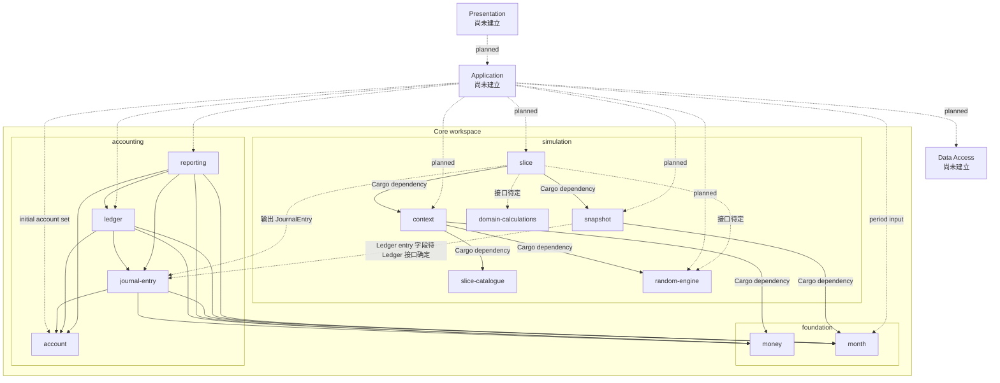
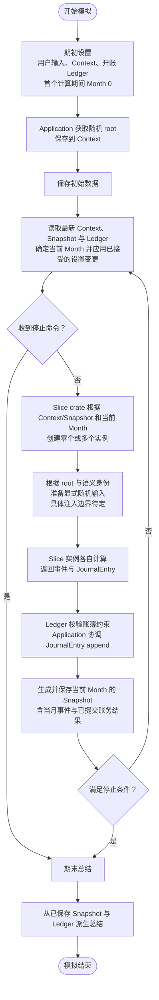

# 项目结构

本文记录当前讨论中的目标边界，不代表所有 crate 或接口已经实现。`core/README.md` 记录 Core 接口设计的后续顺序；冻结的旧实现保留在 `crates/` 作为参考，不属于活动 workspace。Core、Application 和各 Presentation 入口使用各自的 Cargo workspace，可在同一仓库内独立维护并按依赖方向组合。

## 模块与依赖方向

根目录 `Cargo.toml` 是活动 Core crates 的 workspace 根；成员按职责放在 `core/foundation/`、`core/accounting/` 和 `core/simulation/` 目录中，这些目录只是组织方式，不是嵌套 workspace。冻结的旧 crates 保留在 `crates/` 并从 workspace 排除。使用 `cargo check --workspace` 检查活动 Core。实线表示已声明的 Cargo crate 依赖：`slice → context/snapshot`、`snapshot → month`、`context → random-engine/slice-catalogue/money`、`journal-entry → account/money/month`、`ledger → account/journal-entry/money/month` 和 `reporting → account/journal-entry/ledger/money/month`。虚线表示目标但尚未接入的类型关系。`slice-catalogue` 已定义 kind 和设置集合；除贷款参数外，各 Slice 参数 struct 仍是显式占位。`random-engine` 和 `domain-calculations` 当前彼此独立。

目标流程仍是由 Application 取得系统随机 root 并保存到 Context；Core 不访问系统熵。Random engine 根据 root 和语义身份派生显式随机输入。账务流程为 Slice 返回已验证的 `JournalEntry`、Ledger 校验其账户引用等账簿约束并追加、reporting 从 journal 派生结果。实线与虚线区分已实现依赖和目标关系，避免把计划中的 crate 依赖画成现状。

## 模块与类型归属

| 模块 | 应拥有的数据与类型 | 对外能力/接口方向 | 当前状态与未决问题 |
|---|---|---|---|
| Money / Currency | 精确金额、币种、算术与舍入错误 | 解析、构造、访问和 checked 运算 | `core/foundation/money` 已有独立实现；后续核对 Ledger 所需精度与舍入接口 |
| Month | 一次模拟内从 0 开始的月份序号；`Month(0)` 是首个计算月 | 比较、checked 递增/偏移、间隔计算；作为 Snapshot 期间键 | `core/foundation/month` 已建立；不代表真实年份，也不是全局 ID |
| Account | `AccountCode`、账户名称、账户类别、可选 `AccountRole`、正常余额方向和 `AccountCatalogue` | Application 构造账户值和集合；Ledger 校验分录账户引用 | `core/accounting/account` 已实现账户构造、代码校验及集合内代码唯一性校验；role 是不透明机器键，报表如何解释待定 |
| JournalEntry | 月份、一组账户分录和可选标准化 note | Slice 构造并返回零个或多个已验证的复式记录 | `core/accounting/journal-entry` 已建立；note 当前是规范化不透明代码，代码词表及其与来源追溯的关系待具体 Slice 设计 |
| Ledger | 注入的账户目录、币种、独立期初余额、append-only journal 和净余额投影 | 初始化、追加 `JournalEntry`、读取账户余额与 journal | `core/accounting/ledger` 已实现；验证期初账簿平衡、账户/币种引用、非递减月份和原子追加。余额为带符号 Money（借方为正，贷方为负） |
| Reporting | 试算余额、资产负债表、期间损益、现金账户变动及账务审计投影 | 消费账户目录、币种、期初余额和 journal 切片，返回只读报表 | `core/accounting/reporting` 已建立；不调用 Ledger。现金流分类和活动来源追溯待 AccountRole 与 JournalEntry 来源字段确定 |
| Context | 必需的模拟名称、用户初始值、停止条件、Slice 设置、可选最新设置和系统提供的随机 root | 无 latest override 时使用初始设置；更新保留初始值、名称和 root | `core/simulation/context` 持有名称、initial/latest settings 和 root。名称由 Application 提供；`UserSettings` 含币种、房产价值、期初贷款余额/条款、`Vec<StopCondition>` 和 `SliceSettings`。权益由房产价值减贷款余额推导，期初现金默认为零且不单独建字段。整体校验仍待完成 |
| Snapshot | 某个已完成月份的事件和结果 | 保存当月事实，供后续计算读取 | `core/simulation/snapshot` 当前含月份键和 `Vec<Event>`；Ledger 提交结果待 Ledger 类型确定后加入。历史事件留在各月 Snapshot，不建 active/inactive 事件队列 |
| Event | 已发生的领域事实类型 | Slice 计算产生，记录在 Snapshot | `Event` enum 当前有租金收取、维修发生、维修费用结算、贷款还款、房产税缴纳、公用事业计费六类；事件字段待定 |
| Slice | 各领域行为配置、实例构造规则和计算 | 每种 Slice 自行创建零个或多个实例；实例统一 `evaluate()`，返回事件和零个或多个 `JournalEntry` | `core/simulation/slice` 当前有集合入口和实例 trait 草案；完整结果接口与来源追溯字段待具体 Slice 设计 |
| Slice catalogue | 系统支持且由 Context 提供参数的 Slice 类型 | `SliceSetting` 将 kind、每 Slice 参数及适用的用户启用值绑定；`SliceSettings` 封装按 kind 索引的集合 | `core/simulation/slice-catalogue` 定义 `Loan`、`PropertyTax`、`Rental`、`RepairOccurrence`、`RepairCost`、`Utility`。Loan 固定条款在不可变初始值中；RepairCost 不单独启用；`SliceGroup`/依赖顺序留作技术债。其余 Slice 参数 struct 仍是占位，见 ADR-41/42 |
| Random engine | root key、语义身份、随机输入派生 | 从 root 与身份派生显式随机输入；不访问系统熵 | `core/simulation/random-engine` 已有 root、identity、stream 草案；Slice 如何获得派生输入需与实例创建接口一起定 |
| Domain calculations | 可由多个 Slice 复用的纯数学算法 | 接收数学参数和显式随机输入，返回数值/抽样结果 | `core/simulation/domain-calculations` 目前为空壳；伯努利抽样、离散均匀整数抽样及摊还公式可评估是否复用。Slice 专属参数换算仍归各 Slice |
| Application | 用户用例、跨月流程、账户集合与 Month 组装、停止条件、保存协调及系统随机 root 获取 | 调用通用 Core 能力并调用 Data Access | 不拥有会计规则或 Slice 专属计算规则；负责协调 Slice 计算与 Ledger append |
| Data Access | DTO、数据库 schema、SQLite 读写 | 实现 Application 的持久化边界 | 不进入 Core；按已定 Core 类型建立映射 |

### Slice 结果边界

当前目标是让每个 Slice 实例统一返回一个共同的结果值，包含：

- 当月发生的领域事件；
- 零个或多个提交给 Ledger 的 `JournalEntry`。

现金流由已提交 Ledger 推导，不作为 Slice 的平行金额输出。样本属于评估输入；若需审计，应随当月有效输入记录，不把它当成领域事件。未来实例和贷款期限等延续数据优先从事件、配置和 Ledger 派生；只有确认无法派生的状态才另行建模。

## 目标模拟流程（接口待定）

此流程图不规定 Application 如何逐个调用 Slice、也不规定 Accounting/Ledger 由哪个 Core 函数组合；它只标出已讨论的职责与数据流。具体调用协议需等 Context 定义归属、Ledger 交易类型和 Slice 共同结果类型确定后再补。
