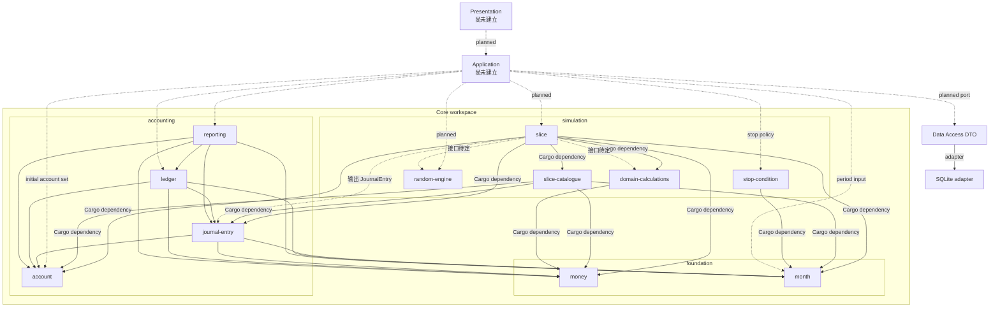
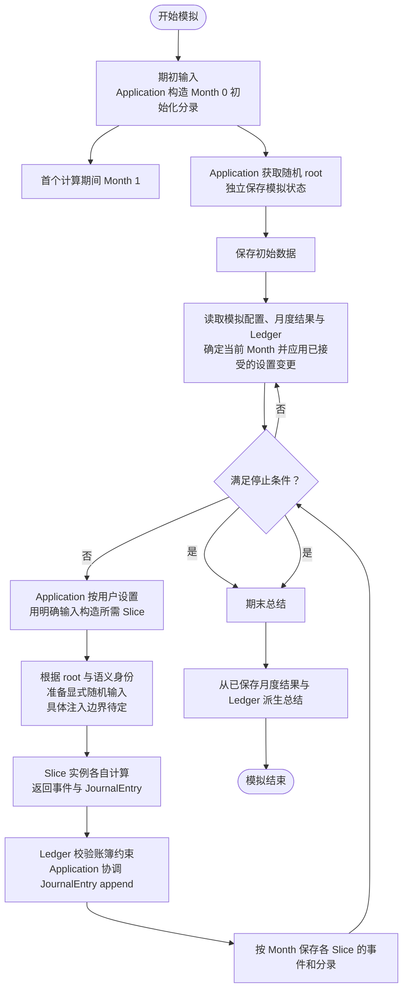

# 项目结构

本文记录当前讨论中的目标边界及实现状态。`core/README.md` 记录 Core 接口设计的后续顺序；冻结的旧实现保留在 `crates/` 作为参考，不属于活动 workspace。Core、Application 和各 Presentation 入口使用各自的 Cargo workspace，可在同一仓库内独立维护并按依赖方向组合。

## 模块与依赖方向

根目录 `Cargo.toml` 是活动 Core crates 的 workspace 根；成员按职责放在 `core/foundation/`、`core/accounting/` 和 `core/simulation/` 目录中，这些目录只是组织方式，不是嵌套 workspace。冻结的旧 crates 保留在 `crates/` 并从 workspace 排除。使用 `cargo check --workspace` 检查活动 Core。实线表示已声明的 Cargo crate 依赖：`slice → account/domain-calculations/journal-entry/month/money/slice-catalogue`、`slice-catalogue → account/journal-entry/month/money`、`domain-calculations → money`、`stop-condition → month`、`journal-entry → account/money/month`、`ledger → account/journal-entry/money/month` 和 `reporting → account/journal-entry/ledger/money/month`。虚线表示目标但尚未接入的类型关系。Slice 参数和每期输入由 catalogue 定义；模拟级配置与月度结果聚合由 Application 负责。

目标流程是由 Application 取得系统随机 root 并作为独立模拟状态持有，Data Access 单独持久化；Core 不访问系统熵。Random engine 根据调用方传入的 root 和语义身份派生显式随机输入。账务流程为 Slice 返回已验证的 `JournalEntry`、Ledger 校验其账户引用等账簿约束并追加、reporting 从 journal 派生结果。实线与虚线区分已实现依赖和目标关系，避免把计划中的 crate 依赖画成现状。

## 模块与类型归属

| 模块 | 应拥有的数据与类型 | 对外能力/接口方向 | 当前状态与未决问题 |
|---|---|---|---|
| Money / Currency | 精确金额、币种、算术与舍入错误 | 解析、构造、访问和 checked 运算 | `core/foundation/money` 已有独立实现；后续核对 Ledger 所需精度与舍入接口 |
| Month | 一次模拟内从 0 开始的时间位置；Month 0 是初始化边界，Month 1 是首个计算月 | 比较、checked 递增/偏移、间隔计算；作为月度结果期间 | `core/foundation/month` 已建立；不代表真实年份，也不是全局 ID |
| Account | `AccountCode`、展示名称、`AccountClass`、必需且目录内唯一的 `AccountRole`、正常余额方向和 `AccountCatalogue` | Application 构造账户值/目录，并按 role 解析 `AccountCode`；Ledger 校验分录账户引用 | `core/accounting/account` 提供 code/role 双向唯一目录；JournalEntry 分录使用 AccountCode，AccountClass 只用于会计分类 |
| JournalEntry | Month 和一组账户分录；Month 0 用于初始化，Month 1 起用于实际模拟 | Slice 构造并返回零个或多个已验证的复式记录；初始化流程构造 Month 0 分录 | `core/accounting/journal-entry` 已建立；只承载复式账务事实，不携带通用备注或活动来源元数据 |
| Ledger | 币种与 append-only JournalEntry 序列；余额是分录投影 | 追加时注入账户目录校验；需要余额时注入目录并按分录推导 | `core/accounting/ledger` 不拥有账户目录或独立 OpeningBalance；期末余额由 JournalEntry 重算 |
| Reporting | 试算余额、资产负债表、期间损益、分类现金流及账务审计投影 | 消费账户目录、币种、JournalEntry 序列和调用方提供的现金流分类映射，返回只读报表 | `core/accounting/reporting` 已建立；不调用 Ledger 或推断科目语义；Opening 分录不计入月度现金流 |
| Application-owned simulation state | 模拟名称、初始输入、当前 Slice 配置、停止条件和随机 root 等独立事实 | Application 组织更新并协调读取；Data Access 分别持久化 | 不保留 Core `Context` 聚合；具体字段和值类型仍由 Application/Data Access 边界设计 |
| Monthly results | 单个 Slice 的事件和 JournalEntry，以及月度所需的延续事实 | Application 按 Month 收集并持久化；后续输入由 Application 组装 | 不保留 Core `Snapshot` 聚合；`SliceResult` 仍是单个 Slice 调用的结果契约 |
| Event / SliceResult | Slice 输出契约：事件和单个 Slice 的单月结果 | `slice-catalogue` 定义，Slice 产生；Application 按 Month 收集 | `SliceResult` 绑定 Month 和 `SliceKind`，校验 Event kind 及 JournalEntry 的月份；Loan、Rental、FixedExpense、RepairOccurrence 和 RepairCost 均有单月输入输出契约 |
| Slice | 各领域行为计算 | 从 catalogue 接收参数和每期输入，返回该 kind 的 `SliceResult` | Loan、Rental、FixedExpense 实现 `DeterministicSlice::calculate`；RepairOccurrence、RepairCost 实现 `StochasticSlice::simulate` 并显式接收随机源。各 Slice 返回具体错误类型；Application 调用已选择的具体 Slice |
| Slice catalogue | 支持的 Slice 清单及其参数、输入、输出类型契约 | `SliceKind`、各 Slice 参数/输入和 `SliceResult` 定义计算边界；配置集合归 Application | `core/simulation/slice-catalogue` 定义当前 Slice 的参数与输入契约，以及共享 Event、SliceResult；不负责配置聚合或 Slice 调度 |
| Random engine | root key、语义身份、随机输入派生 | 从 root 与身份派生显式随机输入；不访问系统熵 | `core/simulation/random-engine` 已有 root、identity、stream 草案；Slice 如何获得派生输入需与实例创建接口一起定 |
| Stop condition | 停止条件值及月度边界的纯判定 | 接收已完成 Month 和贷款结清事实，任一条件满足即停止 | `core/simulation/stop-condition` 不依赖 Ledger 或 Slice；Application 提供事实并决定何时检查 |
| Domain calculations | 无 IO 的纯领域计算函数及其结果/错误值 | 接收明确的计算输入，返回金额或计算结果 | `core/simulation/domain-calculations` 已实现固定利率贷款的月供与月度分摊计算；Slice 校验活动状态并组装事件和复式分录 |
| Application | 用户用例、跨月流程、账户集合与 Month 组装、停止条件、保存协调及系统随机 root 获取 | 调用通用 Core 能力并调用 Data Access | 不拥有会计规则或 Slice 专属计算规则；负责协调 Slice 计算与 Ledger append |
| Data Access | storage-neutral DTO、数据库 schema、SQLite 读写 | DTO 位于 `data-access` crate；`data-access/sqlite` 映射 DTO 与 SQLite 并提供异步存取；主机创建并注入 SQLx pool | 已定义各 Slice 设置、月度事件、账务分录与待结算维修实例 DTO；Application-facing port 仍待用例定稿 |

### Slice 结果边界

每个 Slice 调用返回一个绑定计算月份的共同结果值，包含：

- 当月发生的领域事件；
- 零个或多个提交给 Ledger 的 `JournalEntry`。

现金流由已提交 Ledger 推导，不作为 Slice 的平行金额输出。随机样本属于评估输入，不作为月度持久化结果保存。当前维修间隔可从已持久化的维修结算事件月份派生；贷款剩余期数由总期限和当前月份推导，贷款活动由 Ledger 余额决定。未来若新增无法从月份、事件、配置和 Ledger 派生的状态，再为具体领域行为建模。

## 目标模拟流程（接口待定）

此流程图不规定 Application 如何逐个调用 Slice、也不规定 Accounting/Ledger 由哪个 Core 函数组合；它只标出已讨论的职责与数据流。具体调用协议需在 Application 定义窄的用例接口时确定。
